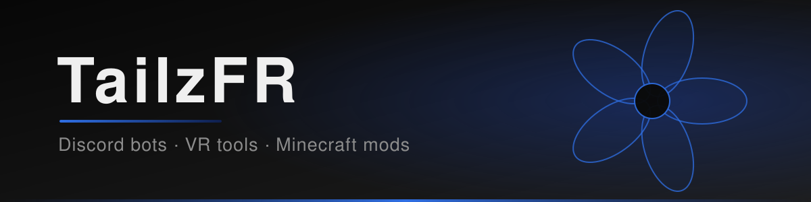

  

<h2>Hi there, I'm TailzFR</h2>

I write code in a few different languages and like building tools: Discord bots, VR add-ons and Minecraft mods. Right now I am working on <a href="https://github.com/TailzFR/spine-client">Spine Client</a>, a client-side utility mod with a schematic auto-builder and a petal-style menu.

  
  

<h3>When I code, I rely on</h3>

  
  
  
  
  
  
  
  
  
  
  

<h3>What I've built</h3>

<ul>
  <li><a href="https://github.com/TailzFR/spine-client">Spine Client</a>: a Fabric 1.21.11 utility client with a schematic auto-builder, HUD modules and a custom menu.</li>
  <li><a href="https://github.com/TailzFR/all-in-1-moderation-bot">all-in-1-moderation-bot</a>: a Discord ticket, appeal and moderation bot built on discord.py Components V2.</li>
  <li><a href="https://github.com/TailzFR/tailz-music-driver">tailz-music-driver</a>: a SteamVR add-on that controls Spotify, YouTube, SoundCloud and more from your left VR controller.</li>
</ul>

<h3>My GitHub contributions summary</h3>

  

  
  

